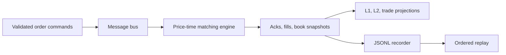

# Solace Trading Lab

[](https://github.com/Noptus/solace-trading-lab/actions/workflows/tests.yml)

A Python laboratory for event-driven data pipelines: order commands become venue events, market-data projections, and replayable records. It connects a price-time matching engine to a publish/subscribe interface, with an in-memory path for reproducible experiments and an optional Solace PubSub+ adapter.

**Status:** educational infrastructure simulator, developed with AI assistance. The useful evidence is executable behavior, tests, and explicit design limits. Hardware modules model assumptions; they do not demonstrate FPGA expertise, kernel bypass, exchange-compatible SBE, or production trading performance.

## Run in five minutes

Requires Python 3.12+ and [uv](https://docs.astral.sh/uv/).

```bash
git clone https://github.com/Noptus/solace-trading-lab.git
cd solace-trading-lab
uv sync --frozen --no-editable
uv run --frozen --no-editable pytest
uv run --frozen --no-editable python examples/replay_demo.py
```

The demo runs entirely in memory. It replays a fixed command stream twice, checks identical output digests, and checks the expected FIFO fills, duplicate rejection, and final book. It needs no credentials, model calls, market data subscription, or running broker.

## Follow the data



| Entry point | What it demonstrates |
| --- | --- |
| [Replay demo](examples/replay_demo.py) | A small end-to-end data pipeline with deterministic output checks |
| [Order book](src/exchange/orderbook.py) | Decimal prices, integer quantities, FIFO queues, partial fills, IOC, cancel/replace |
| [Schemas](src/common/models.py) | Pydantic validation and explicit event contracts |
| [Message bus](src/common/solace_client.py) | A shared interface for synchronous tests and a real broker adapter |
| [Market data](src/market_data/feed.py) | Projections from fills and snapshots into L1/L2/trade messages |
| [Recorder](src/replay/recorder.py) / [player](src/replay/player.py) | JSONL persistence and replay ordered by recording sequence |
| [Tests](tests/) | Matching, strategies, timing models, network models and binary framing |
| [Design note](docs/blog_post.md) | Tradeoffs, failure modes and what still needs evidence |

## Verification boundaries

- The offline suite covers matching behavior and simulation modules. CI runs it on Linux with a frozen dependency lock.
- Deterministic output requires fixed inputs **and an injected clock**. Live services use wall-clock time. The demo excludes transport receipt times from its output digest.
- The in-memory bus is synchronous. Its tests do not establish real broker concurrency, ordering under reconnect, durable delivery, or exactly-once processing.
- The Solace adapter uses **direct messaging**. A JSONL recording is not a transactional event store. Replaying into an existing live book can duplicate effects; the demo always creates fresh state.
- The binary codec has a custom SBE-inspired header. It has not been checked for exchange or FIX SBE interoperability. Python buffer operations allocate; the ring model carries no verified lock-free or cross-thread memory-ordering guarantee.
- Clock, gateway and topology delays are configured simulation values. They are separate from Python wall-clock measurements and are not calibrated to a trading firm's infrastructure.
- No archived experiment establishes a P&L improvement, profitable strategy, or trading capacity claim.

## Optional broker path

```bash
docker compose up -d
./scripts/setup_solace.sh
./scripts/run_all.sh
```

Review [docker-compose.yml](docker-compose.yml), [settings](src/common/config.py), and the scripts before starting local services. The broker path requires separate integration validation; passing offline tests does not certify it.

## Development priorities

Replay now rejects sequence gaps/duplicates before publishing and resumes recording at a validated sequence. The next useful work is a measured broker integration test, reconnect recovery, explicit stream identity and a benchmark with a declared workload and machine. Broader hardware simulation should follow evidence rather than add unsupported performance claims.
